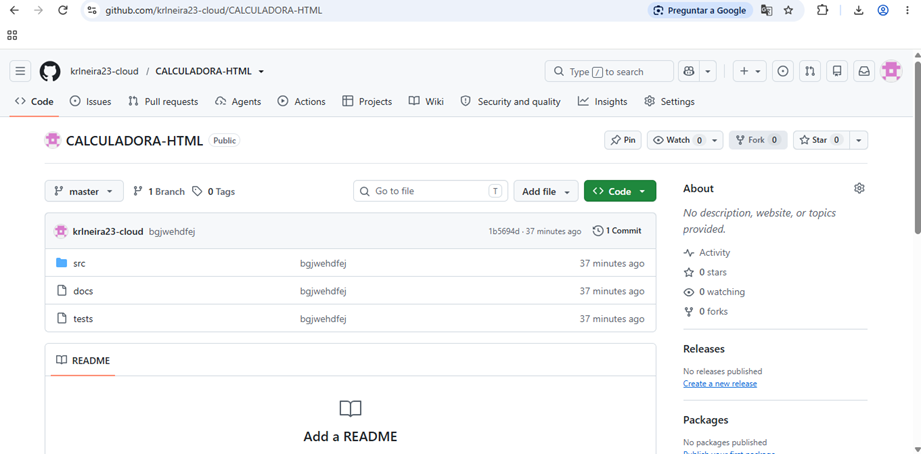
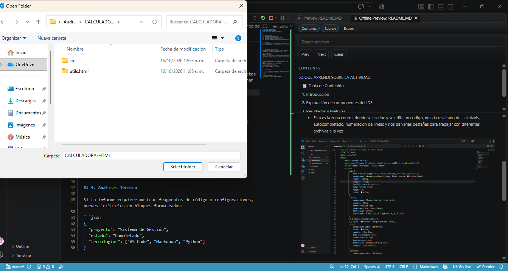
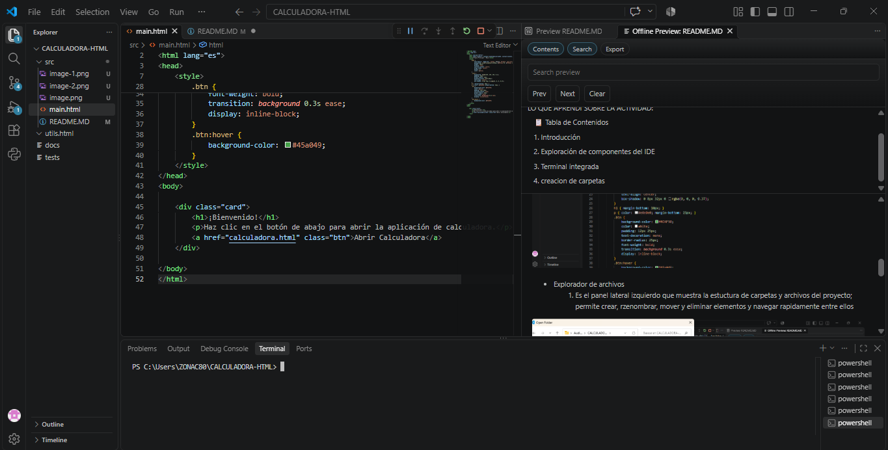
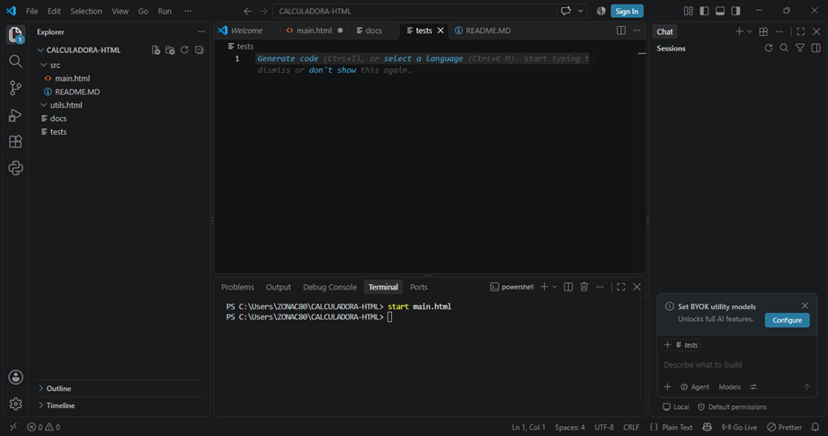
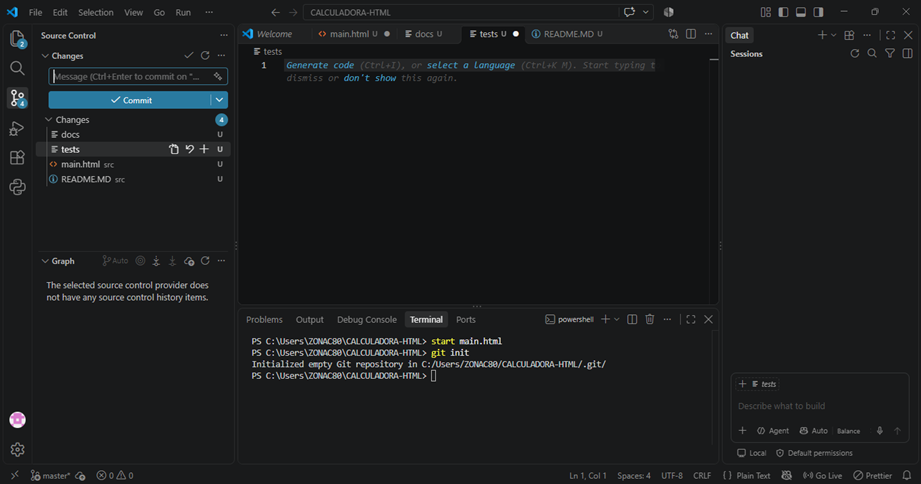
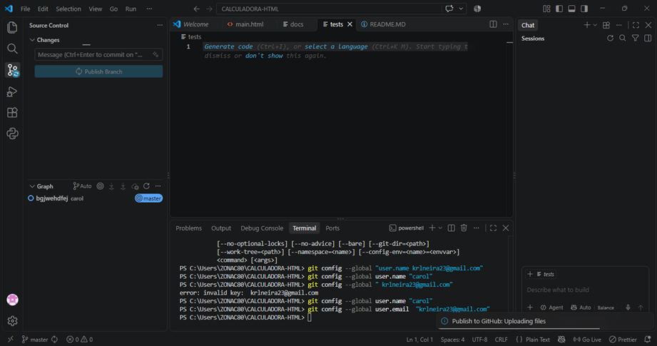

<!-- ENCABEZADO / PORTADA SIMPLE -->
# LO QUE APRENDI SOBRE LA ACTIVIDAD:
- NOMBRE DEL ESTUDIANTE: CAROL JINETH NEIRA BUITRAGO 
  

---

<!-- ÍNDICE DE CONTENIDOS -->
## 📋 Tabla de Contenidos
- [1. Introducción](#1introducción)
- [2. Exploración de componentes del IDE](#2-exploracion-de-componentes-del-IDE-)
- [3. Terminal integrada](#3-terminal-integrada)
- [4. Creación de carpetas](#4-creacion-de-carpetas)
- [5. Inicialización en Git](#5-inicialización-de-git)
- [6. Inicialización en Git hub](#6-inicialización-en-hit-gub)
-[7.Subir la carpeta a Git hub](#7-subir-la-carpeta-a-hit-hub)

---

## 1. Introducción
En esta actividad explore los componentes principales de Visual Studio Code, personalice su interfaz segun la actividad y cree un proyecto con una estructura organizada. 

---

## 2. Exploración de componentes del IDE 
* Esta es la zona contral donde se escribe y se edita un codigo, nos da resaltado de la sintaxis, autocompletado, numeracion de lineas y nos da varias pestañas para trabajar con diferentes archivos a la vez 

* Explorador de archivos 
  1. Es el panel lateral izquierdo que muestra la estuctura de carpetas y archivos del proyecto; permite crear, rzenombrar, mover y eliminar elementos y navegar rapidamente entre ellos

---

## 3. Terminal integrada

Permite ejecutar comandos. (ej:usar Git) sin salir del IDE

---

## 4. Creacion de carpetas
para tener los archivos en carpetas diferentes y asi no tener una confución

## 5. Inicializacion en Git
Para mostrar los cambios que se hagan en el repositorio de Visual Studio Code

## 6. Inicialización en Git Hub
Permite guardar instantáneas (commits) de tu código a medida que avanzas, de modo que puedas volver a una versión anterior si algo falla.

## 7. Subir la carpeta a Git Hub 
sirve para almacenar y sincronizar el historial de tu proyecto en la nube.

Al hacer esto, tu proyecto deja de existir únicamente en tu computadora y pasa a estar disponible en la plataforma de GitHub.

## Conclución
Conocer los componentes del IDE y personalizarlos permite trabajar de forma más cómoda y eficiente. Además, una estructura de proyecto organizada, con carpetas separadas para el código, la documentación y las pruebas, y el uso de entornos virtuales y control de versiones, facilita el mantenimiento y la colaboración en proyectos de software.